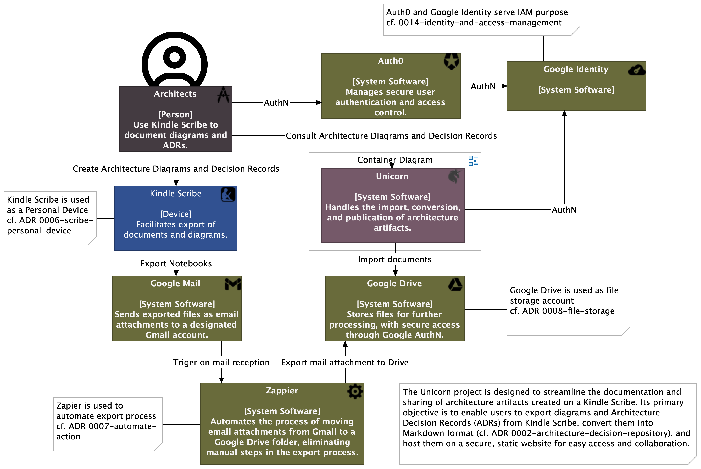
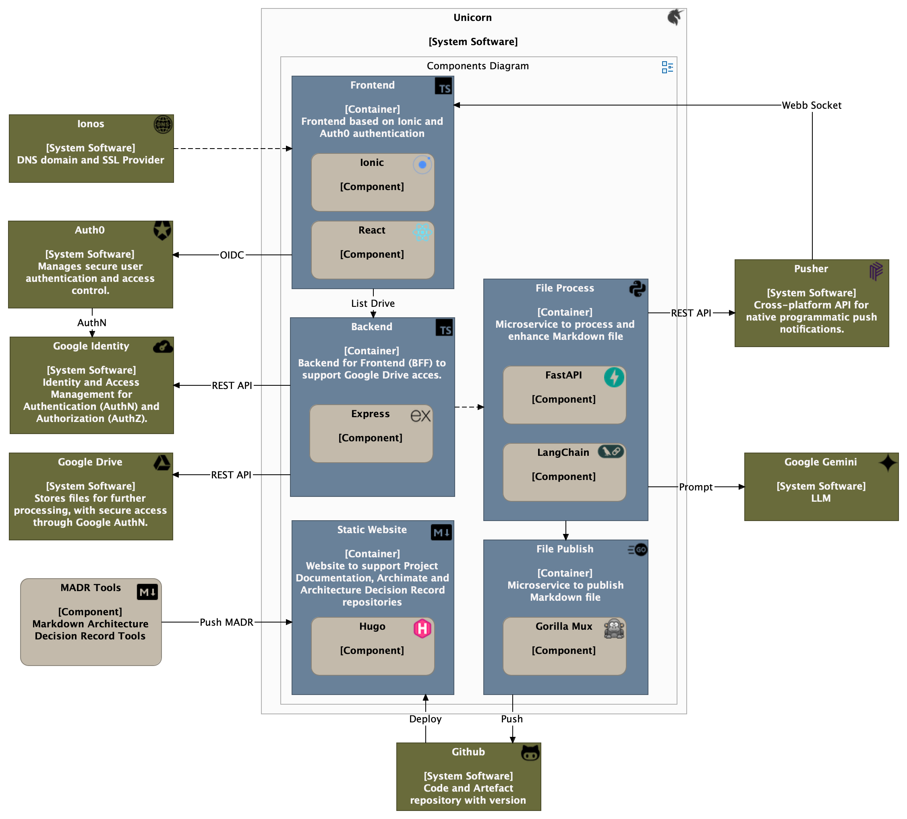

# unicorn-backend
Backend based on [Dapr](https://dapr.io/) for [Unicorn](https://unicorn.royerm.fr) project (cf. [ADR 0017-distributed-application](https://hugo.royerm.fr/adr/0017-distributed-application/))
## Context
The Unicorn project is designed to streamline the documentation and sharing of architecture artifacts created on a Kindle Scribe. Its primary objective is to enable users to export diagrams and Architecture Decision Records (ADRs) from Kindle Scribe, convert them into Markdown format, and host them on a secure, static website for easy access and collaboration.

[](https://s.icepanel.io/bLDUeKPM8K9wn6/VUxj)

Interactive C4 System Context diagram on [IcePanel](https://s.icepanel.io/bLDUeKPM8K9wn6/VUxj).

## System Software Overview
System Software rely on a Frontend/Backend pattern: 
- [Frontend](https://github.com/mickael-royer/unicorn-frontend/) developped on Ionic framework (cf. [ADR 0013-frontend-framework](https://hugo.royerm.fr/adr/0013-frontend-framework/))
- [Backend](https://github.com/mickael-royer/unicorn-backend) developped on Express framework (cf. [ADR 0015-backend-framework](https://hugo.royerm.fr/adr/0015-backend-framework/))
- LLM with RAG integration based on Langchain (cf. [ADR0025-langchain-integration](https://hugo.royerm.fr/adr/0025-langchain-integration/) and [ADR0027-integrate-rag-to-llm-request](https://hugo.royerm.fr/adr/0027-integrate-rag-to-llm-request/)) relying on CosmosDB as a vector database to store C4 diagrams informations (cf. [ADR0026-use-a-vector-database-to-store-c4-diagrams-informations](https://hugo.royerm.fr/adr/0026-use-a-vector-database-to-store-c4-diagrams-informations/)).

[](https://s.icepanel.io/bLDUeKPM8K9wn6/85Ju)

Interactive C4 Container diagram on [IcePanel](https://s.icepanel.io/bLDUeKPM8K9wn6/85Ju).

## Build and Run
### Init dapr with Podman
```
dapr init --container-runtime podman
```
